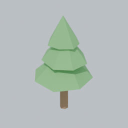

# Filière d'assets 3D low-poly

Mis à jour : 2026-10-24. Demandé par Guillaume, qui ne modélise pas en 3D : chaque avenue est jugée sur ce qu'elle demande à un débutant, à son PC (RTX 2080, 8 Go de VRAM) et en tokens.

## En bref

1. **Filière principale : scripts Blender (`bpy`) écrits par Claude, versionnés dans le dépôt, lancés sans écran dans le conteneur cloud ou en CI.** Essayé ici : `pip install bpy==5.2.3` marche dans le conteneur, un arbre low-poly est généré, exporté en GLB et rendu en vignette en moins d'une seconde et demie. Rien à installer chez Guillaume, rien à apprendre, refaisable à l'identique.
2. **En complément : packs CC0** (Quaternius, Kenney, KayKit) pour le volume (végétation variée, rochers, mobilier) et surtout pour les **personnages animés**, la seule chose vraiment difficile à faire par code. Ils passent dans le même script `bpy` pour être normalisés (budget de triangles, palette, fusion).
3. **Blender MCP sur le PC de Guillaume : optionnel.** Utile pour une séance « je regarde et j'ajuste » dans la fenêtre de Blender, pas comme chaîne de production : non reproductible, PC allumé requis, captures d'écran coûteuses en tokens.
4. **IA image vers 3D : à mettre de côté pour le low-poly.** Sur 8 Go, seuls des modes dégradés tournent (non garantis sur une carte RTX 20), les maillages sortent denses et organiques, et les nettoyer en low-poly propre est justement le travail d'un modeleur. TRELLIS (v1 : 16 Go ; TRELLIS.2 : 24 Go officiellement) ne tourne pas tel quel sur la 2080.

Décision de Guillaume (2026-10-24) : Blender par script. L'arbre du lot 7 de C01 est `tools/blender/tree_lowpoly.py` (PR #12, 340 triangles, GLB identique d'un lancement à l'autre). La vignette ci-dessous vient du premier essai fait pour ce rapport.

## Les avenues comparées

| Avenue | Coût | Ce que Guillaume doit faire | GPU | Reproductible | Tokens par asset | Rendu low-poly |
|---|---|---|---|---|---|---|
| A. Code Godot (SurfaceTool, C#) | 0 | rien | non | oui | faible | bon pour formes simples |
| **B. Scripts `bpy` sans écran (cloud/CI)** | 0 | rien | non | oui | faible | **très bon** : tous les outils de Blender |
| C. Blender MCP sur son PC | 0 | installer Blender 5.1 + l'add-on, garder le PC allumé | non | non (état de la scène) | moyen à élevé (captures) | très bon |
| **D. Packs CC0** | 0 | rien | non | oui | très faible | bon, style imposé par l'auteur |
| E. IA image vers 3D en local (8 Go) | 0 | installer ComfyUI ou un portable Windows, 20 à 30 Go de poids | oui, à la limite | non | moyen | médiocre sans nettoyage |
| F. IA image vers 3D en ligne (offres gratuites) | 0 | créer un compte, téléverser | non | non | faible | médiocre sans nettoyage |
| G. Modéliser à la main | 0 | apprendre Blender (des semaines) | non | non | nul | dépend de l'artiste |

### A. Code Godot

Ce que fait déjà C01 pour le terrain, le drapeau, le golfeur et la balle. Parfait pour des primitives assemblées. Limite : pas de biseau, de décimation, de modificateurs ni de dépliage UV ; chaque forme organique coûte plus de code que dans Blender. À garder pour ce qui dépend de la simulation (terrain, eau, surfaces peintes).

### B. Scripts `bpy` sans écran (recommandé)

**Principe.** Blender existe en module Python (`bpy` sur PyPI, même moteur que l'application). Claude écrit un script qui construit l'objet (primitives, modificateurs, nœuds de géométrie, bruit contrôlé par une graine), l'exporte en `.glb` dans `game/assets/` et rend une vignette PNG. Claude regarde la vignette, corrige le script, relance. Guillaume relit l'image dans la PR, comme il relit déjà les captures de la CI.

**Vérifié dans le conteneur cloud (2026-10-24).**
- `pip download bpy` : roue `bpy-5.2.3-cp313` de 403 Mo pour Linux x86_64 ; Python 3.13 est celui du conteneur, le proxy laisse passer PyPI.
- `import bpy` en 0,8 s ; arbre de 56 triangles (tronc + trois cônes bruités, facettes plates, deux matériaux unis), export GLB de 6 Ko et rendu Cycles CPU 256 px en 0,8 à 1,2 s.
- Décimation d'une sphère de 20 480 triangles à 400 en 0,24 s : la même étape normalise un modèle importé (pack CC0 ou sortie d'IA).
- Installé, le module pèse environ 1 Go : en CI, mettre la roue en cache.

**Pourquoi c'est le meilleur pour un débutant.** Aucune connaissance de Blender n'est demandée : le script est le savoir-faire, il est relu et versionné comme le reste du code. Une variante (« plus touffu », « feuillage d'automne ») est une modification de quelques lignes. Une graine différente donne une forêt d'arbres tous différents. La même chaîne sert ensuite aux bancs, voiturettes, panneaux, bâtiments du club-house.

**Coût en tokens.** Un script fait 80 à 150 lignes ; une vignette de 256 px coûte peu à regarder. Une itération complète (modifier, lancer, regarder) reste de l'ordre de quelques milliers de tokens, sans démarrage d'agent. À comparer avec C : une capture d'écran de viewport en pleine résolution par vérification, plus l'état de la scène à relire.

**Limites.** Claude « sculpte à l'aveugle » entre deux rendus : viser des formes géométriques (ce que demande justement le low-poly), pas des personnages détaillés. L'animation de squelette par script est possible mais lourde : c'est là que D prend le relais.

**Mise en place proposée** (petit chantier, contrôle léger) :
- `tools/blender/` : un script par famille d'assets, tous avec la même interface (graine, sortie) et une petite bibliothèque commune (palette, matériaux unis, export, vignette iso).
- Un job CI « Assets » : installe `bpy` (en cache), régénère les GLB, publie les vignettes dans le journal comme le job « Captures », et échoue si un GLB dépasse son budget de triangles.
- Les GLB générés sont commités pour que Godot les importe sans Blender.

### C. Blender MCP (Claude pilote le Blender ouvert sur le PC)

Deux serveurs gratuits en 2026 :
- **Serveur officiel du Blender Lab** (`projects.blender.org/lab/blender_mcp`, page `blender.org/lab/mcp-server`). Blender 5.1 ou plus, add-on + petit processus `blender-mcp` lancé par le client MCP. Exécution de code Python, résumés de scène et de fichiers `.blend`, captures, rendus, recherche dans la doc de l'API. Pas de génération 3D. Disponible comme connecteur Claude depuis fin avril 2026. Le Blender Lab prévient que le code généré s'exécute « sans garde-fou » et conseille une machine sans données sensibles.
- **MCP for Blender** (communautaire, ex-`ahujasid/blender-mcp`, renommé en septembre 2026). Blender 3.0 ou plus, licence MIT, branchements optionnels vers Poly Haven, Hyper3D Rodin, Hunyuan3D et Tripo. Mode sûr optionnel.

Pour Golferoo, le MCP n'apporte rien que B n'ait déjà pour produire un asset : dans les deux cas Claude écrit du `bpy`. Il ajoute la fenêtre de Blender où Guillaume voit l'objet changer en direct, au prix d'une session sur son PC (Remote Control ou Claude Desktop), d'un état de scène non versionné et de captures plus coûteuses. Usage conseillé : ponctuel, pour explorer un style, puis figer le résultat dans un script B.

### D. Packs CC0 (domaine public, sans attribution)

| Pack | Contenu utile au golf | Licence | Formats |
|---|---|---|---|
| [Quaternius, Stylized Nature MegaKit](https://quaternius.com/packs/stylizednaturemegakit.html) | 40 arbres, 35 plantes et fleurs, 27 rochers, herbes, buissons ; 60 à 70 % gratuits | CC0 | glTF, FBX, OBJ |
| [Quaternius, Universal Animation Library](https://quaternius.com/packs/universalanimationlibrary.html) et Universal Base Characters | personnages riggés et animations partagées : base des futurs golfeurs animés | CC0 | glTF, FBX |
| [Kenney, Minigolf Kit](https://www.kenney.nl/assets/minigolf-kit) | 125 pièces de parcours de minigolf | CC0 | 3D (glTF chez Kenney en général) |
| Kenney (200+ packs, dont nature et ville) | props, mobilier, véhicules | CC0 | GLB, FBX, OBJ |
| KayKit (Kay Lousberg), packs gratuits | props et personnages au style très uni | CC0 | glTF, FBX, OBJ |
| Poly Pizza | archive de l'ancien Google Poly, 10 600 modèles | surtout CC-BY, parfois CC0 : vérifier un par un | GLB |

Avantages : immédiat, cohérent dans un même pack, aucune VRAM. Limites : le style est celui de l'auteur (mélanger deux packs se voit), et rien n'est propre au golf moderne. Règle proposée : prendre de préférence un seul style dominant (Quaternius pour nature et personnages), passer chaque modèle importé dans un script B qui applique la palette du jeu et le budget de triangles, et noter la source et la licence dans un `CREDITS.md` même pour du CC0.

### E. IA image vers 3D en local, sur une RTX 2080 de 8 Go

| Outil | VRAM | Sur RTX 20 (Turing) | Licence | Verdict |
|---|---|---|---|---|
| TRELLIS (v1) | ~16 Go | non | MIT | hors de portée |
| TRELLIS.2-4B, officiel | 24 Go, testé sur A100/H100 sous Linux | non | MIT | hors de portée |
| TRELLIS.2 en GGUF Q4 (fork ComfyUI) | ~6 à 6,5 Go en pointe, ~8 min par modèle | non confirmé (exemples sur RTX 30/40) | MIT pour les poids d'origine ; installeurs `.bat` tiers | essai possible, sans garantie |
| Hunyuan3D-2mini / 2GP (forme seule) | 4 à 6 Go avec délestage, 32 Go de RAM conseillés | lent, support variable selon les versions | **licence Tencent : ne s'applique pas dans l'UE, au Royaume-Uni ni en Corée du Sud** | possible hors de ces pays, texture trop lourde |
| Stable Fast 3D (Stability AI) | modeste, moins d'une seconde par image | probable | Community License : gratuit sous 1 M$ de revenu annuel | le plus « low-poly » des trois (maillage léger, UV dépliés), qualité inégale |

Ce qu'aucun tableau ne montre : la sortie est un maillage organique de dizaines de milliers de triangles avec une texture photo. Le ramener à 400 triangles en couleurs plates passe par une décimation (B le fait en 0,24 s) qui donne souvent une silhouette « fondue » plutôt qu'un vrai style low-poly. Plus l'installation (Python, CUDA, 20 à 30 Go de poids, antivirus qui bloque des `.bat`) : c'est l'avenue la plus technique pour un débutant, et la moins sûre sur cette carte.

### F. IA image vers 3D en ligne, offres gratuites

- **Meshy, offre gratuite** : 100 crédits par mois ; modèles sous **CC BY 4.0** (usage commercial avec attribution), licence privée à partir de Pro.
- **Tripo, offre gratuite** : 200 à 300 crédits par mois selon les sources ; **usage non commercial**. À éviter pour le jeu.
- Hunyuan3D en ligne : mêmes réserves de territoire que la licence locale.

Utile pour un essai ponctuel d'une forme organique difficile (un animal, une statue de trophée), à nettoyer ensuite par B. Pas pour l'arbre ni le gros des assets.

## Recommandation et suite

1. **Lot 7 de C01** : fait par `tools/blender/tree_lowpoly.py` (PR #12), sans TRELLIS ni session sur le PC de Guillaume. Prochaines variantes possibles : plusieurs silhouettes (feuillu, conifère, palmier) par graine.
2. **Guide pour une autre IA** : `docs/guide-ia-assets-3d.md` (conventions, gabarit testé, exemple de prompt).
3. **Chantier suivant (court)** : bibliothèque commune `tools/blender/` et job CI « Assets » décrits en B.
4. **Quand viendront les golfeurs animés** : partir de Quaternius (personnages + animations CC0), normalisés par B.
5. **Blender MCP** : à installer seulement si Guillaume veut voir et ajuster un style en direct ; le serveur officiel du Blender Lab est le choix par défaut.
6. **IA image vers 3D** : en réserve pour une forme organique ponctuelle ; si c'est le cas, Meshy gratuit (attribution) avant toute installation locale.

## Sources

- Blender Lab, serveur MCP : https://www.blender.org/lab/mcp-server/
- Comparatif des serveurs MCP Blender (StraySpark, éditeur d'un serveur concurrent, non vérifié contre les sources primaires) : https://www.strayspark.studio/blog/official-blender-mcp-server-comparison-2026
- Connecteur Claude pour Blender : https://digitalproduction.com/2026/04/30/anthropic-funds-blender-ships-claude-connector/
- TRELLIS.2-4B : https://huggingface.co/microsoft/TRELLIS.2-4B/blob/main/README.md
- TRELLIS.2 en GGUF sur 6 Go : https://dailytopai.com/article/how-to-run-trellis-2-3d-ai-locally-on-just-6gb-vram-with-gguf-44.html
- Licence Hunyuan3D 2 : https://huggingface.co/tencent/Hunyuan3D-2/blob/main/LICENSE
- Hunyuan3D sous Windows, VRAM : https://codersera.com/blog/set-up-hunyuan3d-2-on-windows-a-step-by-step-guide/amp/
- Stable Fast 3D : https://huggingface.co/stabilityai/stable-fast-3d
- Meshy, crédits et licences : https://docs.meshy.ai/en/webapp/pricing
- Tripo, offre gratuite : https://www.costbench.com/software/ai-3d-generation/tripo-ai/free-plan/
- Sites de modèles libres : https://app.cinevva.com/fr/guides/free-3d-model-sites
- Kenney Minigolf Kit : https://www.kenney.nl/assets/minigolf-kit
- Quaternius : https://quaternius.com/packs/stylizednaturemegakit.html
