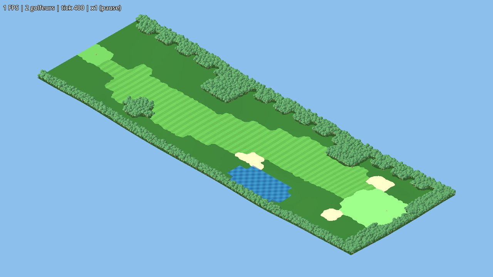

# Rapport du prototype C01 : un trou en 3D low-poly

Mis à jour : 2026-10-24. Spec : `specs/C01-prototype-trou.md`. Lots 1 à 8, PR #6 à #14.

## En bref
- Les choix de l'ADR 0001 tiennent : la simulation est en C# pur, déterministe et très en dessous de ses budgets, et le rendu Godot 4.7 .NET ne laisse pas voir la grille.
- **Facteur recommandé : 2** (cellules de 4 m). Les détails sont plus bas, et la décision revient à Guillaume.
- Un brief d'une ligne confié à un agent a donné une retouche en moins d'une minute, mais seulement à moitié juste : la couleur des bunkers a changé, mais pas l'arbre affiché.
- Il reste à relever les FPS sur le PC de Guillaume et à noter son verdict sur les captures.

## Critères d'acceptation

| # | Critère | Résultat | Preuve |
|---|---|---|---|
| 1 | Tests en local et en CI, au moins un par module, partie complète d'une paire en moins de 5 s | ✅ 84 tests ; la partie complète d'une paire prend 0,17 s | CI « Simulation » ; `GolferTests.FullGame_PairPlaysHoleAndExits` |
| 2 | Déterminisme : même graine, même somme de contrôle | ✅ | `WorldTests.SameSeed_SameChecksum`, `ShotTests.FullGame_SameSeed…`, et la fumée sous Godot |
| 3 | La CI échoue quand un test casse (sim et fumée Godot) | ✅ prouvé au lot 1 | PR #6 (commits de démonstration puis retrait) |
| 4 | `Golferoo.Sim` sans Godot | ✅ | étape CI « Golferoo.Sim ne référence pas Godot » et `ArchitectureTests` |
| 5 | Banc aux facteurs 2, 3 et 4 | ✅ tout passe | tableau ci-dessous, artefact `bench` de la CI |
| 6 | 60 FPS ou plus à 200 golfeurs en 1080p sur le PC de Guillaume | ⏳ à relever | `Mesurer FPS.bat` de l'artefact `golferoo-windows` |
| 7 | 8 captures dans `docs/prototype-c01/`, verdict de Guillaume « pas en cases » | ⏳ captures prêtes, verdict à noter | `docs/prototype-c01/` |
| 8 | Retouche par un agent sur un brief d'une ligne, chronométrée | ✅ 54 s et 47 052 tokens, résultat partiel | section « Retouche par agent » |
| 9 | Le rapport tranche le facteur | ✅ recommandation : 2 | section « Facteur » |
| 10 | `CLAUDE.md` donne les commandes réelles | ✅ | section « Stack et commandes » |

## Banc (CI, runner GitHub ubuntu-latest, .NET 10.0.13, commit c99772f)

| Mesure (budget) | Facteur 2 (96×32) | Facteur 3 (144×48) | Facteur 4 (192×64) |
|---|---|---|---|
| Tick à 200 golfeurs, moyenne (< 2 ms) | 0,024 ms | 0,014 ms | 0,015 ms |
| Tick à 200 golfeurs, p99 (< 5 ms) | 0,05 ms | 0,02 ms | 0,02 ms |
| Champ de flux sur le trou (< 5 ms) | 0,45 ms | 0,28 ms | 0,51 ms |
| Champ de flux sur 512×512, médiane (< 20 ms) | ≈ 14 ms | 13,3 ms | 13,1 ms |
| Retouche 5×5 avec 13 champs en cache, p99 (< 16 ms) | 2,3 ms | 4,2 ms | 7,2 ms |

- Le champ 512×512 porte sur la même carte aux trois facteurs. Il est jugé sur la médiane depuis le lot 8 : sur un runner partagé, une fois sur une dizaine, la moyenne a dépassé 20 ms (pire valeur, 36 ms) à cause des pauses du ramasse-miettes. Chaque champ alloue environ 2 Mo sur le tas des gros objets. Pour les vraies cartes, il faudra réutiliser ces tampons.
- Un coup au driver planifié coûte environ 15 ms. Ce coût n'est pas mesuré quand plusieurs groupes jouent dans le même tick. C'est à surveiller avant d'avoir des parcours chargés.

## FPS (critère 6)
À remplir avec `fps-result.txt` : carte graphique, FPS moyen, 1 % bas, tick moyen, résolution, facteur.

## Captures (critère 7)
Les captures sont produites par la CI (Forward+ en rendu logiciel lavapipe), en 1280×720, au facteur 4 :
- 4 rotations de la vue d'ensemble : `capture-00` à `capture-03` ;
- 4 rotations de la vue du green : `capture-04` à `capture-07` ;
- pour comparer les facteurs : `f2-capture-00`, `f2-capture-04`, `f3-capture-00` et `f3-capture-04`.

Ce qu'on y voit :
- Les bords du fairway, du green et des bunkers sont courbes : le fondu flouté sur 5 m efface les cellules.
- L'eau garde un contour en escalier de cellules. C'est le défaut visible principal ; il faudrait un contour lissé ou appliquer le même fondu à l'eau.
- Les arbres Blender, posés un par cellule, forment des massifs denses. À la lisière, le bord de la carte se lit encore comme une rangée.
- Le zoom « green » de la caméra est trop serré pour juger le trou en entier. C'est un réglage de capture, pas un défaut du jeu.

Verdict de Guillaume : à noter.

## Facteur de subdivision (critère 9)
**Recommandation : facteur 2, soit des cellules de 4 m et 2 × 2 sous-cases par tuile de 8 m.**
- **Visuellement**, les facteurs 2 et 4 sont presque indiscernables en vue d'ensemble comme au green : comparer `f2-capture-00` et `capture-00`. Le fondu de 5 m domine, et une forme plus petite que 5 m est lissée quel que soit le facteur.
- **Le coût** est négligeable au tick, mais il croît avec la surface :
  - la retouche p99 passe de 2,3 ms au facteur 2 à 7,2 ms au facteur 4 ;
  - un champ de flux occupe 4 fois plus de mémoire au facteur 4.
  - Pour un 18 trous d'environ 1 500 × 1 000 m, avec une soixantaine de champs en cache, cela donne de l'ordre de 30 Mo au facteur 2 contre 120 Mo au facteur 4. C'est une estimation : 5 octets par cellule et par champ.
- **Ce que le facteur 4 apporterait** : un pinceau plus fin (2 m) et des pentes plus détaillées. Le prototype ne montre pas que ça se voit.
- **À changer si Guillaume valide** :
  - `Main.DefaultFactor` passe de 4 à 2 ;
  - l'ADR 0001 dit « facteur 2 retenu » au lieu de « de l'ordre de 2 à 4 » ;
  - le coût annoncé du champ de flux dans l'ADR passe de « vers 5 ms en 512×512 » à 13 ms, mesuré.
- **Si Guillaume préfère la finesse**, le facteur 3 est le compromis : retouche à 4,2 ms.

## Retouche par agent (critère 8)
- **Brief** : « Dans le jeu Golferoo : bunkers plus clairs et arbres plus ronds. » Seul s'y ajoutait le cadre de rendu : commit dans un worktree, compte rendu en 10 lignes.
- **Agent** : Sonnet, à froid, dans un worktree isolé. **54 s, 47 052 tokens, 8 appels d'outils.**
- **Résultat** :
  - Le sable passe de (0,89 ; 0,82 ; 0,55) à (0,96 ; 0,91 ; 0,68) dans `terrain.gdshader`. C'est visible sur les captures.
  - Les arbres ne changent pas à l'écran. L'agent a arrondi l'arbre de repli de `ProceduralMeshes.Tree()`, alors que le jeu affiche `tree.glb`, produit par `tools/blender/tree_lowpoly.py`.
  - L'agent n'a rien vérifié à l'image : il n'y a pas de Godot dans le conteneur.
- **Leçon** : une retouche « d'une ligne » marche quand l'asset à changer est évident depuis le code qui l'affiche. Il faut écrire en tête de `TreeLayer` d'où vient l'arbre (c'est fait), ou nommer le fichier dans le brief. La relecture des captures de la CI aurait montré le raté. Voir `docs/lecons.md`.

## Assets (lot 7)
- Golfeur, balle, drapeau et arbres de repli sont générés par code. Ils comptent 162, 80, 27 et 258 triangles, et se construisent en moins de 4 ms chacun.
- L'arbre affiché vient d'un script Blender (`bpy`) lancé dans le cloud : 340 triangles, 1 s, et la même graine redonne le même fichier.
- TRELLIS a été écarté : la carte de Guillaume a 8 Go de mémoire vidéo, en dessous des quelque 16 Go demandés. La comparaison des filières est dans `docs/assets-3d.md`.

## Ce que le prototype a appris
- Godot 4.7.2 .NET compile en `net10.0`. Il tourne sans écran en CI, pour la fumée et pour les captures en rendu logiciel. Il s'exporte pour Windows depuis Linux, à condition d'ajouter une solution `game/Golferoo.Game.sln`.
- Le conteneur cloud n'a ni Godot ni accès aux artefacts. Les captures passent donc par le journal de la CI, en JPEG base64 sur les lignes `THUMB` et `FULL`.
- Le JSON du trou est copié dans `game/data/` à la compilation et embarqué dans l'export.

## Suites proposées
1. Contour lissé pour l'eau.
2. Réutiliser les tampons des champs de flux, et mesurer la planification des coups sous charge.
3. Un job CI « Assets » qui régénère les `.glb`, comme le propose `docs/assets-3d.md`.
